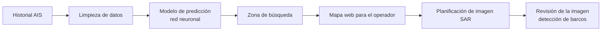

# SAR-AIS-PLATAFORMA-PREDICTIVA

**Tesis de Magíster: predecir dónde estará un barco para orientar imágenes satelitales SAR**

> 🔒 **Código privado.** Este repositorio es un *showcase* de mi trabajo de grado (Magíster en Ingeniería Informática, Universidad Andrés Bello). El código y los datos de trabajo no se publican. Las cifras corresponden a una simulación académica.

**Estado:** tesis de Magíster defendida (2026). Trabajo de grado realizado en dupla.

## English summary
Master's thesis project: a platform that uses a ship's AIS history to estimate where it will be in the next hours and points the satellite radar (SAR) search there, instead of using only its last known position. In a simulation of 200 cases, the learned model located 163 ships versus 131 with a simple straight-line projection, using fewer images (−39.61% total estimated cost, −51.47% cost per ship located). Results come from a historical, simulated setup, not from a real operation.

## Problema
Cuando un barco deja de transmitir su posición AIS, sigue moviéndose y su última posición conocida queda desactualizada. Las imágenes de radar satelital (SAR) permiten ver el mar de día, de noche y con nubes, pero cada imagen cuesta dinero y cubre un área acotada. Si la imagen se pide sobre la última posición, muchas veces solo muestra mar vacío.

**La pregunta:** cuando un barco apaga su AIS, ¿dónde conviene pedir la imagen SAR para volver a encontrarlo gastando menos?

## Enfoque
1. **Datos:** registros AIS históricos públicos (NOAA, 2024), revisados y limpiados.
2. **Modelo:** una red neuronal lee 12 horas de historia del barco y estima su posición hasta 36 horas después.
3. **Comparación:** se compara contra una regla simple que proyecta la última posición en línea recta con el mismo rumbo y velocidad.
4. **Evaluación:** 200 casos simulados, con las mismas reglas para ambos métodos, contando cuántos barcos se encuentran y cuántas imágenes se necesitan.
5. **Plataforma:** mapa web donde se ve el historial, la predicción y la zona de búsqueda propuesta, más un apoyo para revisar una imagen SAR ya tomada.

## Arquitectura

## Stack
Python · PyTorch · FastAPI · Astro · React · Leaflet · YOLO (revisión de imágenes) · Docker con GPU

## Resultados (simulación de 200 casos)
| Indicador | Modelo propuesto | Proyección en línea recta |
|---|---|---|
| Barcos localizados | 163 / 200 | 131 / 200 |
| Imágenes usadas | 2.877 | 4.764 |
| Reducción de costo total estimado | 39,61 % | — |
| Reducción de costo por barco localizado | 51,47 % | — |

Notas: los costos son una estimación técnica y las pasadas del satélite fueron simuladas; no es un ahorro real ni una prueba en operación. "Localizado" significa que la posición real quedó dentro de alguna imagen planificada. La meta inicial era reducir al menos 50 % el costo; se observó una reducción de 51,47 % por barco localizado, pero la muestra no permite afirmarlo con certeza estadística.

## Capturas
<!-- TODO: captura del mapa con historial y predicción (sin datos sensibles) -->

<!-- TODO: GIF o figura comparando predicción vs línea recta -->

## Autor
Tito Ruiz Haros · [github.com/titoruizh](https://github.com/titoruizh)
